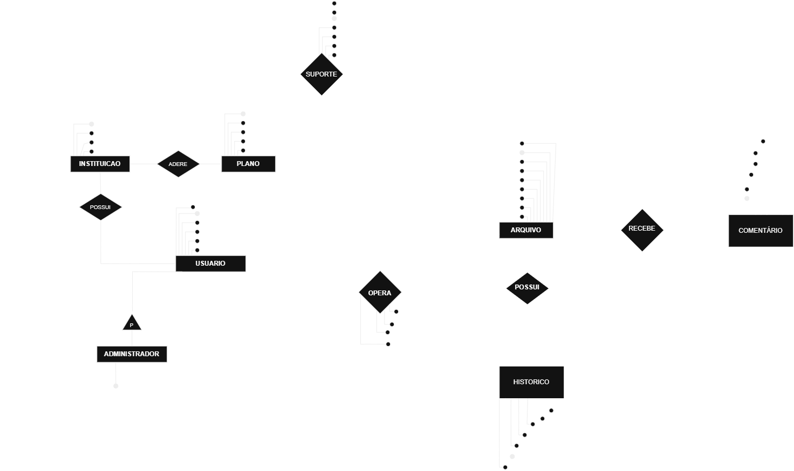
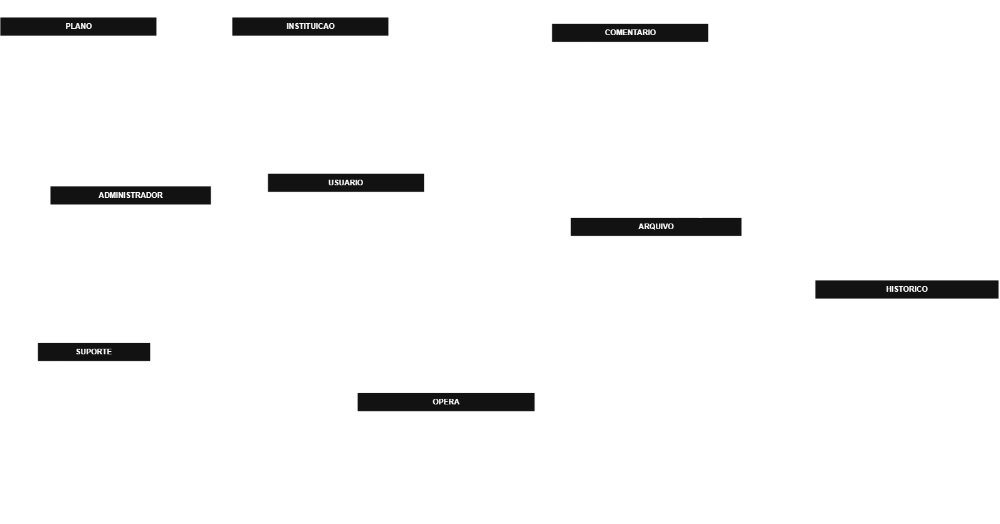

# Banco de dados — implementação física

Este diretório reúne a implementação em **MySQL** do banco de dados do projeto. O modelo representa um sistema de armazenamento e compartilhamento de arquivos entre usuários e instituições, com recursos de controle de acesso, comentários, histórico de alterações, suporte e auditoria de operações.

Os scripts estão separados por responsabilidade para facilitar a criação do esquema, a carga de dados, a consulta e a manutenção dos objetos do banco.

## Diagramas

Os diagramas registram a evolução da modelagem. Os arquivos `.drawio` podem ser abertos e editados no [diagrams.net](https://app.diagrams.net/).

### Modelo conceitual



[Abrir o arquivo editável do modelo conceitual](../Diagramas/DiagramaConceitual.drawio)

### Modelo lógico



[Abrir o arquivo editável do modelo lógico](../Diagramas/DiagramaLogico.drawio)

> **Observação:** os diagramas representam a modelagem do projeto. O arquivo [`ddl/02_criacao-entidade.sql`](ddl/02_criacao-entidade.sql) é a referência atual da implementação física e inclui tabelas auxiliares adicionadas durante o desenvolvimento.

## Estrutura do diretório

| Diretório | Conteúdo |
| --- | --- |
| [`ddl/`](ddl/) | Criação do banco `web_driver`, das tabelas, chaves primárias e chaves estrangeiras. |
| [`dml/`](dml/) | Exemplos de inserção, atualização e remoção de registros. |
| [`dql/`](dql/) | Consultas de leitura e pesquisa. |
| [`function/`](function/) | Funções auxiliares para identificar o usuário e a instituição autenticados e verificar a data de arquivos. |
| [`views/`](views/) | Visões específicas para usuários, empresas e administradores. |
| [`triggers/`](triggers/) | Regras automáticas de segurança, definição de proprietário e atualização de atividades. |
| [`procedures/`](procedures/) | Rotinas para consultar atividades e administrar acessos a arquivos. |
| [`roles/`](roles/) | Criação dos papéis `PapelUsuario`, `PapelEmpresa` e `PapelAdm`, com suas permissões. |

## Principais entidades

- **Plano e Instituição:** representam os planos contratados e as organizações que os utilizam.
- **Usuário e Administrador:** armazenam as contas do sistema e identificam usuários com função administrativa.
- **Arquivo e Acesso_Arquivo:** registram os arquivos, seus proprietários e os compartilhamentos com outros usuários.
- **Comentário, Opera e Histórico:** registram colaboração, operações realizadas e alterações nos arquivos.
- **Suporte e Atividades_Recentes:** acompanham solicitações de suporte e a atividade dos arquivos.
- **Conta_Empresa:** associa uma conta MySQL a uma instituição para filtrar as visões empresariais.

## Controle de acesso

| Papel | Acesso previsto pelos scripts atuais |
| --- | --- |
| `PapelUsuario` | Consulta arquivos públicos, próprios ou compartilhados; consulta o histórico permitido; insere e atualiza dados por meio da visão destinada ao usuário. |
| `PapelEmpresa` | Consulta os usuários e arquivos vinculados à instituição identificada pela conta autenticada. |
| `PapelAdm` | Possui operações de consulta, inserção, atualização e remoção nas tabelas explicitamente listadas no script do papel, além de acesso à visão administrativa. |

As funções `id_usuario_atual()` e `id_instituicao_atual()` relacionam o nome da conta MySQL autenticada — a parte anterior ao `@` — aos registros de `Usuario.login` e `Conta_Empresa.login`, respectivamente.

## Pré-requisitos

- MySQL 8.0 ou versão superior, devido ao uso de papéis (`ROLE`).
- Cliente de linha de comando `mysql` ou outra ferramenta compatível, como MySQL Workbench.
- Uma conta com permissão para criar banco, tabelas, funções, visões, gatilhos, procedimentos, usuários e papéis.

## Ordem recomendada de execução

Execute os scripts a partir da raiz do repositório. No cliente `mysql`, a sequência básica é:

```sql
SOURCE database/ddl/01_criacao-bd.sql;
USE web_driver;
SOURCE database/ddl/02_criacao-entidade.sql;

SOURCE database/function/id-usuario-atual.sql;
SOURCE database/function/id-instituicao-atual.sql;
SOURCE database/function/function-100.sql;

SOURCE database/views/view_usuario.sql;
SOURCE database/views/view_usuario_arquivo.sql;
SOURCE database/views/view_usuario_historico.sql;
SOURCE database/views/view_empresa_usuarios.sql;
SOURCE database/views/view_empresa_arquivos.sql;
SOURCE database/views/view_admin.sql;

SOURCE database/triggers/safe-security.sql;
SOURCE database/triggers/definir-dono.sql;
SOURCE database/triggers/atualizar-acesso.sql;
SOURCE database/triggers/registrar-operacoes.sql;

SOURCE database/procedures/conta-usuario.sql;
SOURCE database/procedures/remover-acesso.sql;
SOURCE database/procedures/chaver.sql;
SOURCE database/procedures/verificar-atividade.sql;

SOURCE database/roles/papel-usuario.sql;
SOURCE database/roles/papel-empresa.sql;
SOURCE database/roles/papel-adm.sql;
```

Os scripts de [`dml/`](dml/) e [`dql/`](dql/) são exemplos de manipulação e consulta. Execute-os separadamente e apenas quando quiser testar essas operações.

## Como executar

1. Abra um terminal na raiz do repositório.
2. Inicie o cliente MySQL com uma conta administrativa:

   ```powershell
   mysql -u root -p
   ```

3. No prompt do MySQL, execute os comandos da seção anterior na ordem apresentada.
4. Confira os objetos criados:

   ```sql
   USE web_driver;
   SHOW TABLES;
   SHOW FULL TABLES WHERE Table_type = 'VIEW';
   SHOW TRIGGERS;
   SHOW PROCEDURE STATUS WHERE Db = 'web_driver';
   SHOW FUNCTION STATUS WHERE Db = 'web_driver';
   ```

## Cuidados antes da execução

- Os scripts de papéis criam contas de demonstração com senhas definidas diretamente nos arquivos. Substitua essas credenciais antes de utilizar o banco em um ambiente compartilhado ou de produção.
- Alguns arquivos de funções e procedimentos incluem uma chamada de demonstração (`SELECT` ou `CALL`) ao final. Verifique se os registros usados nos exemplos existem antes de executar essas chamadas.
- Os scripts de atualização e remoção em [`dml/`](dml/) alteram dados existentes; revise os identificadores antes de executá-los.
- A ordem é importante: funções devem existir antes das visões que as utilizam, e as visões devem existir antes da concessão das permissões aos papéis.

---

[Voltar ao README principal](../README.md)
